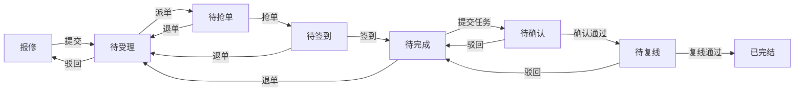

# 原 App 流程核对（2026-10-16）

范围：原 APK 1.0.64 的客户端代码，以及当前账号可读取的两套 ASSET_FAULT 流程定义、一套 ERP_OUTBOUND 流程定义。仅查询元数据，没有提交、受理、驳回、退单、签到、出库或切换真实厂区。

另对八种状态各读取了两张现有工单，并读取首张工单当前节点的表单选项。七个未完结状态返回的操作与下表一致；已完结不返回待办操作。这是只读核对，并非模拟提交。

## 维修主流程与返回分支

部分配置另有待受理“指派”直达待签到，以及报修／受理“关单”结束分支，详见下表。

| 当前节点 | 操作 | 去向 |
|---|---|---|
| 报修／开始任务 | 提交 | 待受理 |
| 报修／开始任务 | 关单 | 结束 |
| 待受理／派单受理 | 派单 | 待抢单 |
| 待受理／派单受理 | 驳回 | 报修／开始任务 |
| 待受理／派单受理 | 关单 | 结束 |
| 待受理／派单受理 | 指派 | 待签到；当前两套定义中仅一套包含此分支 |
| 待抢单 | 抢单 | 待签到 |
| 待抢单 | 退单 | 待受理／派单受理 |
| 待签到 | 签到 | 待完成／完成任务 |
| 待签到 | 退单 | 待受理／派单受理 |
| 待完成／完成任务 | 提交任务 | 待确认 |
| 待完成／完成任务 | 退单 | 待受理／派单受理 |
| 待确认 | 确认通过 | 待复线 |
| 待确认 | 驳回 | 待完成／完成任务 |
| 待复线 | 复线通过 | 结束 |
| 待复线 | 驳回 | 待完成／完成任务 |

两套维修定义主顺序相同，列表中的八个状态是：报修、待受理、待抢单、待签到、待完成、待确认、待复线、已完结。列表默认待抢单。服务器类别字典还提供 APPROVED／待审批，但这两套维修模型均未配置该节点；不能把字典类别当作必然存在的工单状态。

退单、驳回不是独立顺序状态。退单后回派单受理，报修状态标签可以带“退单”；受理驳回回报修，标签可以带“驳回”。确认和复线的驳回均回维修完成任务，而非回报修。

真实任务的选项和 condition 值必须读取 workflow/getFormPropertiesConditionsByTaskId；实际操作权限必须读取 workflow/getWorkflowTaskState。模型分支并不表示当前用户可以操作所有节点。

## 原字段和表单行为

- 新建报修：根据当前登录用户调用 user/getUserDeptByUserId，带出故障申请人、手机号、首个申请部门；受理部门、受理人、维修班组等仍按原表单选择和联动，不能全部默认成自己。
- 新建 ERP：同样带出申请人、领用人及首个领用部门。项目号、ERP记账部门、出库物料、用途等按原表单填写。
- 派单受理：自修分支提供维修班组、预计完成时间；指派分支选择维修人。外协仍不开发。
- 维修完成任务：故障类型、维修花费、开始／结束时间、辅助维修人、工作说明、图片，以及 ERP 出库／多物料使用数量。
- 维修中新建 ERP：关联维修报修单号；每张 ERP 单包含多种物料，每行保留自己的物料对象、数量与单位，缺少单位用 PCS。
- 签到：原独立页面有二维码／RFID入口，同时流程定义存在签到提交节点。当前只审阅 UI；按之前约定不开发扫描，没有实测签到。
- 流程记录：原接口提供历史节点、当前节点、时间、处理意见；入口应在工单详情明确展示。

## ERP 当前流程

| 当前节点 | 操作 | 去向 |
|---|---|---|
| 开始任务／待提交 | 提交 | ERP物料出库审批 |
| 开始任务／待提交 | 关单 | 结束 |
| ERP物料出库审批 | 通过 | ERP物料出库确认 |
| ERP物料出库审批 | 驳回 | 开始任务／待提交 |
| ERP物料出库确认 | 通过 | 结束 |
| ERP物料出库确认 | 驳回 | 开始任务／待提交 |

客户端支持 EXECUTING 和 CONFIRM 类别填写实发数量；当前这套模型使用 CONFIRM，没有额外 EXECUTING 节点。不能根据通用类别字典额外添加审批步骤。

## 资产与仓库

- 资产详情原有：详情、履历、图片、保养、精密度检查、巡检、维修、盘点。维修页查询 fault/pageSimpleAssetFault，按 asset.assetId 筛选，faultTime 降序。
- 资产维修记录包含报修名称、资产编号／名称、机台号、地址、故障时间、申请人、维修班组、维修受理人、受理部门及状态。
- 原仓库库存：material/pageMaterialInfo，createTime 降序；不同于 ERP 的 erpOutbound/pageErpMaterial。原库存支持仓库、数量、均价等信息。
- 原入库记录：warehouse/pageWarehousing，列表显示 warehousingTime 入库时间；原默认排序仍是 createTime。不得将库存创建时间擅自解释为每条物料的入库时间。
- 当前登录厂区的这两个仓库查询均未返回记录，尚无真实库存明细可核对嵌套字段；本轮截图采用明确标记的示例数据，不能据此宣称已有真实库存。

## 尚未验证

以上为客户端和服务器只读定义核对，尚未进行实际业务写入测试。不同厂区、不同版本实例、任务归属和角色权限可能改变可用选项。原始返回及身份资料仅保存在 .private，不随代码或图册上传。
